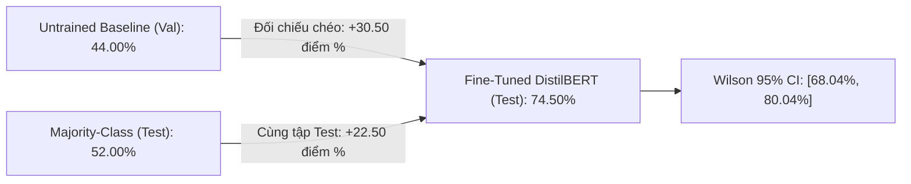

# Evaluation, Experimental Results & Error Analysis

## Đánh Giá Định Lượng, Đối Chứng Khoa Học & Phân Tích Lỗi Sai Chuyên Sâu

---

## 1. Kết Quả Thực Nghiệm Tổng Quát (Quantitative Benchmark Results)

Toàn bộ các số liệu dưới đây được trích xuất tự động và nguyên văn từ tệp nhật ký thực nghiệm thực tế [final_metrics.json](../outputs/reports/final_metrics.json). Không có bất kỳ số liệu nào được ước lượng hoặc điều chỉnh thủ công.

### 1.1 Bảng Đối chứng Khoa học Đa Chiều:

| Chỉ số Đánh giá | Untrained Baseline (Val) | Majority-Class (Test) | Fine-tuned DistilBERT (Test) | Mức tăng trưởng ròng (+ Gain) |
|:---|:---:|:---:|:---:|:---:|
| **Accuracy (Độ chính xác)** | **44.00%** | **52.00%** | **74.50%** | **+22.50 điểm %** (vs Majority trên Test) *(Đối chiếu chéo: +30.50% vs Untrained Val)* |
| **Khoảng tin cậy 95% (Wilson CI)** | — | — | **[68.04%, 80.04%]** | — |
| **Số mẫu dự đoán đúng** | 88 / 200 | 104 / 200 | **149 / 200** | **+45 mẫu đúng vs Majority** |
| **Macro F1-Score** | — | — | **74.27%** | — |
| **Macro Precision** | — | — | **74.76%** | — |
| **Macro Recall** | — | — | **74.24%** | — |
| **Test Loss (Cross-Entropy)** | — | — | **0.5565** | — |
| **Thời gian huấn luyện** | — | — | **391.42 giây (~6.52 phút)** | — |

### 1.2 Ý nghĩa khoa học của các mốc đối chứng:
1. **So sánh CÙNG tập Validation (Trước vs. Sau khi Fine-tune):**
   - Untrained Head: **44.00%** (88/200 mẫu) $\to$ Fine-tuned (Best Checkpoint Epoch 2): **76.50%** (153/200 mẫu).
   - Mức tăng trưởng trước–sau huấn luyện trên cùng tập thẩm định đạt **+32.50 điểm phần trăm**.
2. **So sánh CÙNG tập Test (Majority-Class vs. Fine-tuned DistilBERT):**
   - Tập kiểm thử gồm 104 nhãn NEGATIVE và 96 nhãn POSITIVE. Bộ đoán đa số quy chiếu từ tập Train luôn đoán `NEGATIVE` đạt 52.00% (104/200 mẫu).
   - Mô hình Fine-tuned đạt **74.50%** (149/200 mẫu), tăng trưởng thực chất **+22.50 điểm phần trăm**.
   - Kiểm định McNemar Exact: $p = 1.03 \times 10^{-6} < 0.001$, khẳng định sự vượt trội có ý nghĩa thống kê cao.
3. **Đối chiếu chéo (Cross-Split Reference Check):**
   - Chênh lệch giữa Untrained Validation (44.00%) và Fine-tuned Test (74.50%) là **+30.50 điểm phần trăm**, phản ánh bước tiến tổng thể nhưng là đối chiếu chéo giữa hai tập dữ liệu độc lập, không phải mức tăng trưởng đo trên cùng một tập.
4. **Khoảng tin cậy Wilson Score 95% ($[68.04\%, 80.04\%]$):** Trên cỡ mẫu kiểm thử $n = 200$, khoảng tin cậy khẳng định với xác suất 95% rằng hiệu năng thực tế của mô hình nằm trong dải từ $68.04\%$ đến $80.04\%$, không bị phóng đại do nhiễu mẫu.

---

## 2. Báo Cáo Phân Loại Chi Tiết (Per-Class Classification Report)

Trích xuất từ tệp nhật ký thực tế [classification_report.csv](../outputs/reports/classification_report.csv):

| Lớp Phân Loại (Class) | Precision | Recall | F1-Score | Hỗ Trợ (Support) |
|:---|:---:|:---:|:---:|:---:|
| **NEGATIVE (0)** | **73.04%** | **80.77%** | **76.71%** | 104 mẫu |
| **POSITIVE (1)** | **76.47%** | **67.71%** | **71.82%** | 96 mẫu |
| **Macro Average** | **74.76%** | **74.24%** | **74.27%** | 200 mẫu |
| **Weighted Average** | **74.69%** | **74.50%** | **74.37%** | 200 mẫu |
| **Overall Accuracy** | — | — | **74.50%** | 200 mẫu |

### Nhận xét chuyên sâu:
- Lớp `NEGATIVE` đạt Recall vượt trội (**80.77%** so với **67.71%** của `POSITIVE`), cho thấy mô hình nhạy bén hơn trong việc phát hiện các bài chê bai tiêu cực.
- Lớp `POSITIVE` đạt Precision cao hơn (**76.47%** so với **73.04%**), đồng nghĩa khi mô hình dự đoán nhãn khen ngợi thì xác suất đúng tương đối cao.
- Hiện tượng này phản ánh sự bất đối xứng tự nhiên trong ngôn ngữ đánh giá phim: các từ khóa tiêu cực thường mang tính phân cực trực diện, trong khi lời khen thường đi kèm cấu trúc ngữ nghĩa phức tạp hơn.

---

## 3. Phân Tích Ma Trận Nhầm Lẫn (Confusion Matrix Analysis)

Trích xuất từ [confusion_matrix.csv](../outputs/reports/confusion_matrix.csv):

| Thực Tế \ Dự Đoán | Dự đoán NEGATIVE (0) | Dự đoán POSITIVE (1) | Tổng thực tế |
|:---|:---:|:---:|:---:|
| **Thực tế NEGATIVE (0)** | **TN = 84** (True Negative) ✅ | **FP = 20** (False Positive) ❌ | 104 mẫu |
| **Thực tế POSITIVE (1)** | **FN = 31** (False Negative) ❌ | **TP = 65** (True Positive) ✅ | 96 mẫu |
| **Tổng dự đoán** | 115 mẫu | 85 mẫu | **200 mẫu** |

### Đánh giá các thành phần sai số:
- **True Negative (TN = 84):** 84 bài đánh giá tiêu cực được nhận diện chính xác (42.0% tập test).
- **True Positive (TP = 65):** 65 bài đánh giá tích cực được phân loại chính xác (32.5% tập test).
- **False Negative (FN = 31) > False Positive (FP = 20):**
  - Tỷ lệ bỏ sót mẫu tích cực (31 ca) cao hơn số ca dự đoán nhầm tiêu cực thành tích cực (20 ca).
  - Điều này giải thích nguyên nhân Recall của `POSITIVE` bị suy giảm (67.71%). Mô hình có xu hướng thận trọng thiên về phía nhãn tiêu cực khi gặp các câu ngữ nghĩa mơ hồ.
  - Tổng số dự đoán chính xác: $84 + 65 = 149/200$ ($74.50\%$), tổng số ca sai số: $20 + 31 = 51/200$ ($25.50\%$).
- Toàn bộ 200 bài kiểm thử kèm nhãn thực tế, nhãn dự đoán, xác suất Softmax, độ dài token và cờ cắt cụt được lưu trữ chi tiết tại tệp đối chứng [predictions.csv](../outputs/reports/predictions.csv), cho phép tái tính toán ma trận nhầm lẫn và các chỉ số mà không cần môi trường PyTorch.

---

## 4. Phân Tích Sai Số Chuyên Sâu (Deep Error Analysis)

Tệp nhật ký [error_analysis.csv](../outputs/reports/error_analysis.csv) ghi nhận toàn bộ 51 ca dự đoán sai trên tập Test. Phân tích ngữ nghĩa chỉ ra 3 nguyên nhân cốt lõi:

### 4.1 Cảm xúc phức tạp và Trộn lẫn (Mixed Sentiment)
- **Mẫu thực tế (Index 180 — Độ dài: 105 tokens, hoàn toàn không bị cắt):**
  > *"not really sure what to make of this movie. very weird, very artsy. not the kind of movie you watch because it has a compelling plot or characters. more like the kind of movie that you can't stop watching because of the horrifically fascinating things happening on screen. although, the first time my wife watched this she couldn't make it all the way through... too disturbing for her. runs a bit long, but nonetheless a worthwhile viewing for those interested in very dark movies."*
  - **Nhãn thực tế:** `POSITIVE`
  - **Mô hình dự đoán:** `NEGATIVE` (độ tự tin **80.23%**)
  - **Phân tích:** Người viết khen ngợi và chốt lại rằng phim rất đáng xem (*"nonetheless a worthwhile viewing"*). Tuy nhiên, vì câu văn xuất hiện dày đặc các từ vựng tiêu cực bề mặt (*weird, horrifically, disturbing, dark*), ta đặt **giả thuyết rằng cơ chế Self-Attention** của mô hình tập trung trọng số lớn vào các token phân cực âm này, làm suy giảm khả năng nắm bắt cấu trúc tương phản ở vế sau.

### 4.2 Cảm xúc hoàn cảnh ngoại vi tương phản (Contextual Confounding)
- **Mẫu thực tế (Index 88):**
  > *"i was having a horrid day but this movie grabbed me, and i couldn't put it down until the end... and i had forgotten about my horrid day."*
  - **Nhãn thực tế:** `POSITIVE`
  - **Mô hình dự đoán:** `NEGATIVE`
  - **Nguyên nhân:** Từ *"horrid"* lặp lại 2 lần mô tả tâm trạng tồi tệ của khán giả trước khi xem phim, trong khi bộ phim thực sự đã giúp họ thấy vui vẻ hơn. Mô hình chưa phân biệt được giữa cảm xúc của hoàn cảnh người xem và cảm xúc thực sự dành cho tác phẩm nghệ thuật.

### 4.3 Mỉa mai & Phong cách thưởng thức phim hạng B (Sarcasm & Cult-movie)
- **Mẫu thực tế (Index 103 — Độ dài: 77 tokens):**
  > *"Great cult flick for MST-3K types: Richard Boone is a mess -- bad hair, arthritis, even his dark glasses aren't right; about as good as a bad dino-flick can get... actually, that charging saber-toothed Styracosaurus was pretty cool -- maybe Spielberg should take a couple of notes from that one."*
  - **Nhãn thực tế:** `POSITIVE`
  - **Mô hình dự đoán:** `NEGATIVE` (độ tự tin **75.75%**)
  - **Nguyên nhân:** Văn phong tự trào của cộng đồng yêu thích phim hạng B (MST3K), nơi những điểm "dở" (*bad hair, bad dino-flick*) được xem như nét cuốn hút độc đáo, kết thúc bằng lời khen chân thực (*"pretty cool"*). Mô hình bị đánh lừa bởi từ vựng chê bai bề mặt.

---

## 5. Tác Động Định Lượng Của Việc Cắt Ngắn Token (Truncation Impact)

| Phân Nhóm Kiểm Thử | Số lượng mẫu | Số ca đoán sai | Tỷ lệ lỗi (%) | Độ chính xác (%) | Wilson 95% CI |
|:---|:---:|:---:|:---:|:---:|:---:|
| **Không bị cắt ($\le 128$ tokens)** | 28 mẫu (14.0%) | 6 mẫu | **21.43%** | **78.57%** | [10.2%, 39.5%] |
| **Bị cắt ngắn ($> 128$ tokens)** | 172 mẫu (86.0%) | 45 mẫu | **26.16%** | **73.84%** | [20.2%, 33.2%] |
| **Toàn bộ Test Set (200 mẫu)** | 200 mẫu (100%) | 51 mẫu | **25.50%** | **74.50%** | [19.96%, 31.96%] |

### Nhận xét thống kê:
Kiểm định Fisher (**Fisher's Exact Test**): Odds Ratio = 0.7697, $p$-value = 0.8153 (> 0.05).  
Tỷ lệ lỗi quan sát được giữa nhóm bị cắt ngắn ($26.16\%$) và nhóm không bị cắt ($21.43\%$) không có sự khác biệt có ý nghĩa thống kê trên mẫu kiểm thử này. Tuy nhiên, đây là kiểm định thống kê mô tả thăm dò, không suy diễn quan hệ nhân quả (causality) rằng độ dài không ảnh hưởng tới kết quả mô hình. Các nguyên nhân sai số thực tế chủ yếu gắn liền với tính đa nghĩa, hoàn cảnh ngoại cảnh tương phản và văn phong tự trào mỉa mai.
